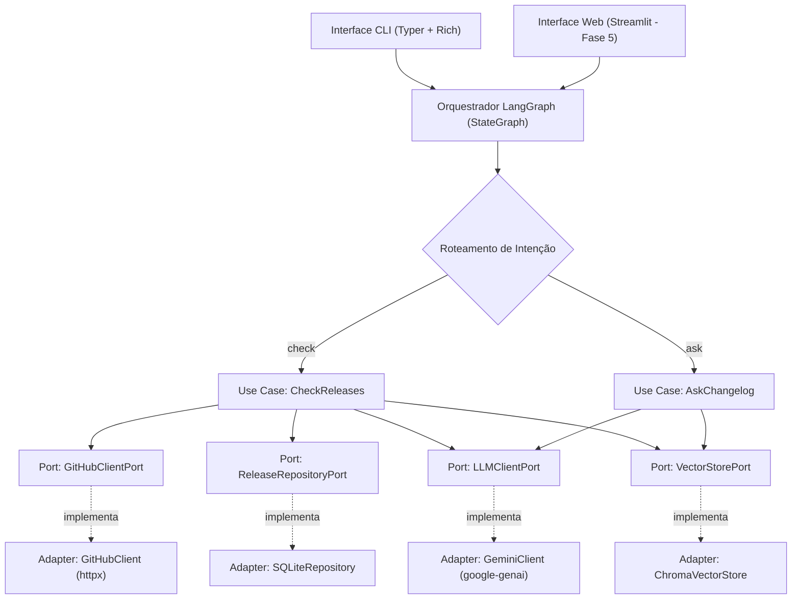
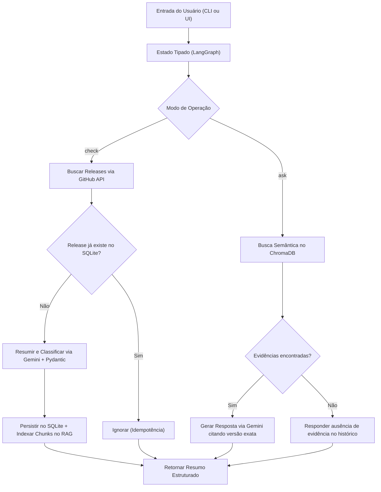

# Arquitetura Técnica — Patch Radar

Este documento detalha a arquitetura de software, os contratos de domínio, a modelagem de dados, o pipeline de RAG, a orquestração com LangGraph, a containerização e a estratégia de testes do **Patch Radar**.

---

## 1. Visão Geral do Sistema

O **Patch Radar** resolve a fragmentação no acompanhamento de atualizações de projetos open source (emuladores, ports nativos, drivers e ferramentas Linux). Em vez de consultar manualmente múltiplos repositórios e interpretar changelogs extensos, o sistema opera em dois fluxos principais:

1. **Modo Radar (`check`):** consulta a GitHub Releases API para os repositórios cadastrados, filtra o que já foi processado no SQLite, gera resumos estruturados e classificação de impacto em português via Google Gemini + Pydantic, persiste o histórico relacional e indexa o conteúdo no banco vetorial.
2. **Modo Pergunta (`ask`):** responde consultas sobre versões anteriores utilizando busca semântica (RAG) sobre os changelogs indexados, fundamentando a resposta com a citação exata da versão de origem.

---

## 2. Diagramas de Arquitetura e Fluxo

### Camadas e Inversão de Dependência (Clean Architecture)



### Fluxo de Execução (`check` e `ask`)



---

## 3. Estrutura de Diretórios

O projeto adota o *src layout* padrão Python (`PEP 517/621`), permitindo empacotamento limpo, isolamento de importações e exposição do entrypoint `patch-radar`:

```text
patch-radar/
├── .github/
│   └── workflows/
│       └── ci.yml                   # Pipeline CI: ruff check, ruff format --check e pytest
├── docs/
│   ├── architecture.md              # Especificação técnica de arquitetura
│   └── roadmap.md                   # Checklist viva de entregas por fase
├── src/
│   └── patch_radar/
│       ├── __init__.py
│       ├── domain/                  # Regras puras, entidades, exceções e ports (zero infra)
│       │   ├── entities.py
│       │   ├── exceptions.py
│       │   └── ports.py
│       ├── use_cases/               # Regras de aplicação orquestrando ports
│       │   ├── manage_repos.py
│       │   ├── check_releases.py
│       │   └── ask_changelog.py
│       ├── adapters/                # Implementações concretas plugáveis
│       │   ├── github_client.py
│       │   ├── sqlite_repository.py
│       │   ├── gemini_client.py
│       │   ├── vector_store.py
│       │   └── agent_graph.py
│       └── interfaces/              # Camadas de entrada
│           ├── cli/
│           │   └── main.py
│           └── ui/
│               └── app.py
├── tests/
│   ├── unit/                        # Domínio e casos de uso isolados com mocks/fakes
│   ├── integration/                 # SQLite (:memory:) e ChromaDB local
│   └── e2e/                         # Fluxos ponta a ponta (CLI + LangGraph + SQLite + RAG)
├── .dockerignore
├── .env.example
├── .gitignore
├── AGENTS.md
├── Dockerfile
├── LICENSE
├── README.md
├── docker-compose.yml
└── pyproject.toml
```

---

## 4. Contratos de Domínio

### Entidades Pydantic (`src/patch_radar/domain/entities.py`)

- **`Repository`**:
  - `id: int | None`
  - `owner: str`
  - `name: str`
  - `category: Literal["emulador", "port", "linux", "driver", "ferramenta"]`
  - `created_at: datetime | None`
- **`ReleaseRaw`**:
  - `repo_name: str` (formato `owner/name`)
  - `tag_name: str`
  - `published_at: datetime`
  - `body: str`
  - `url: str`
- **`ReleaseSummary`**:
  - `repo_name: str`
  - `version: str`
  - `impact_level: Literal["baixo", "medio", "alto"]`
  - `categories: list[str]` (ex.: `["Linux", "Performance", "Controles"]`)
  - `summary_pt: str`
  - `highlights: list[str]`
- **`ChangelogChunk`**:
  - `chunk_id: str` (determinístico: `{repo_name}:{tag_name}:{index}`)
  - `repo_name: str`
  - `tag_name: str`
  - `content: str`
  - `url: str`
- **`ChangelogAnswer`**:
  - `question: str`
  - `answer_pt: str`
  - `cited_versions: list[str]`
  - `sources: list[str]`

### Ports (`src/patch_radar/domain/ports.py`)

Definidos com `typing.Protocol` para desacoplamento estrutural e facilidade de substituição em testes:
- **`GitHubClientPort`**: `fetch_releases(owner: str, name: str, limit: int = 10) -> list[ReleaseRaw]`
- **`ReleaseRepositoryPort`**: cadastro/listagem de repositórios, verificação de existência de release, persistência de release resumido e consultas analíticas (`stats`).
- **`LLMClientPort`**: `summarize_release(release: ReleaseRaw) -> ReleaseSummary` e `answer_from_context(question: str, chunks: list[ChangelogChunk]) -> ChangelogAnswer`.
- **`EmbeddingClientPort`**: `embed_texts(texts: list[str]) -> list[list[float]]`.
- **`VectorStorePort`**: `index_chunks(chunks: list[ChangelogChunk]) -> None` e `search(query: str, top_k: int = 5, repo_name: str | None = None) -> list[ChangelogChunk]`.

### Exceções de Domínio (`src/patch_radar/domain/exceptions.py`)
- `PatchRadarError` (exceção base)
- `ExternalServiceError` (falhas de rede, timeout ou HTTP inesperado)
- `GitHubRateLimitError` (limite de requisições excedido)
- `RepositoryNotFoundError` (repositório inexistente no GitHub ou no banco local)
- `LLMResponseError` (falha de geração ou validação estruturada do modelo)

---

## 5. Persistência Relacional (SQLite)

O adaptador `sqlite_repository.py` utiliza `sqlite3` com SQL explícito, integridade referencial ativada (`PRAGMA foreign_keys = ON`) e unicidade composta para garantir idempotência.

### Schema

```sql
CREATE TABLE IF NOT EXISTS repositories (
    id INTEGER PRIMARY KEY AUTOINCREMENT,
    owner TEXT NOT NULL,
    name TEXT NOT NULL,
    category TEXT NOT NULL,
    created_at TEXT NOT NULL,
    UNIQUE(owner, name)
);

CREATE TABLE IF NOT EXISTS releases (
    id INTEGER PRIMARY KEY AUTOINCREMENT,
    repo_id INTEGER NOT NULL,
    tag_name TEXT NOT NULL,
    published_at TEXT NOT NULL,
    raw_body TEXT NOT NULL,
    impact_level TEXT NOT NULL,
    summary_pt TEXT NOT NULL,
    url TEXT NOT NULL,
    read_at TEXT NOT NULL,
    FOREIGN KEY (repo_id) REFERENCES repositories(id) ON DELETE CASCADE,
    UNIQUE(repo_id, tag_name)
);
```

### Consultas Analíticas Suportadas
- Listagem consolidada com **`JOIN`** entre `repositories` e `releases`.
- Filtragem com **`WHERE`** por repositório, categoria ou nível de impacto (`baixo`, `medio`, `alto`).
- Agregações de cobertura e distribuição de impacto com **`GROUP BY`** para o comando `stats`.

---

## 6. Pipeline RAG (Busca Semântica em Changelogs)

1. **Chunking:** divisão do corpo (`raw_body`) de cada release em blocos controlados com sobreposição (*overlap*) preservando cabeçalhos e contexto de versão.
2. **Embeddings via Port:** geração de vetores por meio de `EmbeddingClientPort` (implementação padrão via `google-genai`, mantendo a imagem Docker leve e permitindo substituição por embeddings locais sem alterar casos de uso).
3. **Armazenamento e Metadados:** persistência no **ChromaDB** (`./data/chroma`) com metadados estruturados (`repo_name`, `tag_name`, `url`) e `chunk_id` determinístico (upsert idempotente).
4. **Mitigação de Alucinação:** o caso de uso `AskChangelog` envia exclusivamente os trechos recuperados para o LLM e exige resposta estruturada (`ChangelogAnswer`) citando versão e fonte; na ausência de contexto relevante, informa explicitamente que não há evidência indexada.

---

## 7. Orquestração com LangGraph

O módulo `adapters/agent_graph.py` implementa um `StateGraph` tipado com:
- **Estado explícito:** intenção (`check` ou `ask`), filtros opcionais, pergunta do usuário, resultados estruturados, contador de iterações e registro de erros.
- **Roteamento condicional:** nó de entrada direciona para o fluxo de verificação de releases ou para o fluxo de consulta RAG.
- **Proteção contra loops:** limite máximo de iterações e encerramento determinístico para `END`.

---

## 8. Containerização e Isolamento de Ambiente

O ambiente de desenvolvimento e execução é integralmente containerizado:
- **Imagem base:** `python:3.12-slim` equipada com `uv`.
- **Ambiente virtual interno:** `UV_PROJECT_ENVIRONMENT=/opt/venv`, mantendo `/opt/venv` fora do diretório de código montado (`/app`) para evitar conflitos com *bind mounts* (`volumes: .:/app`) e eliminar qualquer instalação de pacotes ou `.venv` no host.
- **Persistência:** diretório `./data` mapeado para `/app/data` (armazenando o banco SQLite e a coleção do ChromaDB).
- **Serviços Compose:**
  - `app`: execução da CLI (`patch-radar`), `pytest` e `ruff`.
  - `ui` (`profiles: ["ui"]`, Fase 5): interface Streamlit na porta `8501` reutilizando a mesma imagem.

---

## 9. Estratégia de Testes e CI/CD

### Pirâmide de Testes (`pytest`)
- **Unitários (`tests/unit/`):** validação de entidades Pydantic, exceções, lógica de chunking, adaptadores HTTP/LLM com mocks e casos de uso com implementações *fake* dos `Ports`.
- **Integração (`tests/integration/`):** execução real de queries SQL em SQLite `:memory:` (incluindo `UNIQUE`, `FOREIGN KEY`, `JOIN` e `GROUP BY`) e indexação/consulta real em instância efêmera do ChromaDB com `EmbeddingClientPort` determinístico.
- **Ponta a Ponta (`tests/e2e/`):** execução completa do fluxo da CLI (`CliRunner`) passando pelo grafo LangGraph, SQLite e VectorStore (simulando apenas as fronteiras externas de rede GitHub/Gemini).

### Pipeline CI (`.github/workflows/ci.yml`)
Executado automaticamente em todo `push` e `pull_request`:
1. `ruff check .` (análise estática e padronização).
2. `ruff format --check .` (verificação de formatação).
3. `pytest --cov=patch_radar` (suíte completa de testes com relatório de cobertura).
